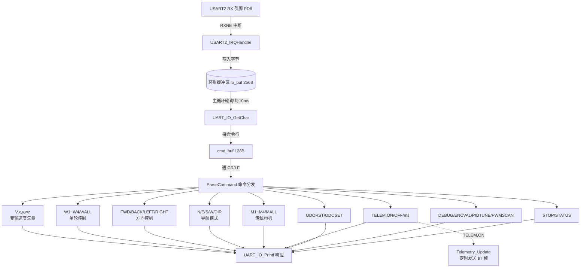
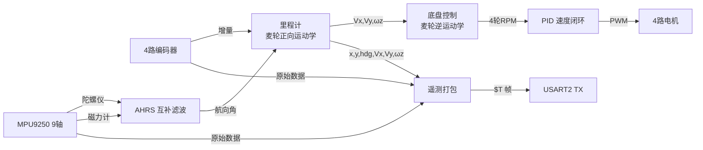

# STM32F407 麦轮小车 — 串口命令参考手册

> **手册基线**：v3.0-ODOMTEST（2026-09-03）· **已核对至 v3.4.8-WHEEL80**（2026-10-22）
> ⚠️ **命令以源码为准**：`Core/Src/main.c`（解析）、`Core/Src/telemetry.c`（遥测帧）。
> 本手册与源码冲突时，**源码优先**。固件版本用 `VERSION` 命令查。

> **硬件接口**：USART2, PD5(TX) / PD6(RX), **460800 8N1**，无流控，TX 为 DMA 异步发送  
> **底盘类型**：麦轮 (Mecanum) 四轮独立驱动  
> **命令格式**：每条命令以回车（`\r` 或 `\n`）结尾，大小写不敏感，前导空格自动跳过  
> **响应格式**：成功返回 `OK ...`，失败返回 `ERR ...`

---

## 目录

- [一、系统命令](#一系统命令)
- [二、麦轮速度矢量控制](#二麦轮速度矢量控制核心)
- [三、单轮独立控制](#三单轮独立控制)
- [四、简单方向控制](#四简单方向控制连续运动)
- [五、导航模式](#五导航模式自动在目标距离停止)
- [六、传统电机命令](#六传统电机命令兼容)
- [七、遥测与里程计](#七遥测与里程计)
- [八、诊断命令](#八诊断命令)
- [九、遥测帧格式](#九遥测帧格式)
- [十、状态上报格式](#十状态上报格式)
- [十一、命令处理架构](#十一命令处理架构)

---

## 一、系统命令

### `STOP` — 紧急停止

停止底盘状态机并关闭全部电机输出。

```
STOP
→ OK STOP
```

### `STATUS` — 查询当前状态

返回底盘状态、航向、行程距离、剩余距离及 4 个电机转速。

```
STATUS
→ $STAT,<state>,HDG=<deg>,DIST=<m>,REM=<m>,M1=<rpm>,M2=<rpm>,M3=<rpm>,M4=<rpm>
```

### `DEBUG` — 调试日志控制

| 命令 | 说明 |
|------|------|
| `DEBUG` | 打印系统信息（时钟频率、调试等级、运行时间） |
| `DEBUG,<0~5>` | 设置日志等级（数字） |
| `DEBUG,<名称>` | 设置日志等级（名称） |

**日志等级说明：**

| 等级 | 名称 | 输出内容 |
|:----:|------|----------|
| 0 | `NONE` | 关闭所有日志 |
| 1 | `ERROR` | 仅致命错误 |
| 2 | `WARN` | 错误 + 警告 |
| 3 | `INFO` | + 关键状态变化（**默认**） |
| 4 | `DEBUG` | + 详细调试（含 1s 心跳） |
| 5 | `VERBOSE` | + 每周期高频数据 |

```
DEBUG              → 打印系统信息
DEBUG,4            → 设置为 DEBUG 等级
DEBUG,VERBOSE      → 设置为 VERBOSE 等级
DEBUG,NONE         → 关闭所有日志
```

### `AHRSMAG` — 磁力计融合开关（2026-08-12 新增）

> 默认 **OFF**（纯陀螺积分）。电机磁场干扰或磁轴未标定时，磁力计会把航向拉偏——建图阶段建议保持 OFF（激光 SLAM 会兜底 yaw 漂移）。

| 命令 | 说明 |
|------|------|
| `AHRSMAG,ON` | 开启磁力计融合（立即用磁航向重置 yaw） |
| `AHRSMAG,OFF` | 关闭（纯陀螺积分） |
| `AHRSMAG` | 查询当前状态 |

### `VERSION` — 固件版本（2026-08-12 新增）

开机自动打印一次，也可随时查询：

| 命令 | 说明 |
|------|------|
| `VERSION` | 打印 `Firmware: v3.0-ODOMTEST (26.08.29)` |

### `TELEM` — 遥测流控制

🆕 控制统一遥测数据帧的发送。

| 命令 | 说明 |
|------|------|
| `TELEM,ON` | 开启遥测流（默认 ASCII $T 帧, 50Hz） |
| `TELEM,OFF` | 关闭遥测流 |
| `TELEM,BIN` | 切换为**二进制帧**（0xAA 0x55 + CRC8, 112B, 含原始 int16 IMU/编码器 + ODOM EKF 诊断） |
| `TELEM,ASCII` | 切换回文本帧 $T（默认, 便于人眼调试） |
| `TELEM,<ms>` | 设置发送间隔并开启（0=最快, 20=50Hz, 100=10Hz） |
| `TELEM,NOW` | 立即按当前模式发送一帧遥测数据 |

```
TELEM,ON        → OK TELEM ON (50Hz)
TELEM,BIN       → OK TELEM BIN (0xAA55+CRC8, 112B, raw + ODOM diag)
TELEM,ASCII     → OK TELEM ASCII ($T text)
TELEM,100       → OK TELEM interval=100ms
TELEM,NOW       → (发送一帧数据)
```

### `ODORST` / `ODOSET` — 里程计控制

🆕 重置或设置里程计位姿（x, y 世界坐标）。

| 命令 | 说明 |
|------|------|
| `ODORST` | 里程计归零（x=0, y=0，航向保持） |
| `ODOSET,<x>,<y>,<hdg>` | 设置里程计位姿（x=m, y=m, hdg=°） |

```
ODORST              → OK Odometry reset (x=0, y=0)
ODOSET,1.5,2.0,90   → OK Odometry set: x=1.500 y=2.000 hdg=90.0
```

---

## 二、麦轮速度矢量控制（核心）

> 🆕 **麦轮专用命令**。直接控制机器人坐标系下的速度矢量。  
> 连续运动，需 `STOP` 停止。使用 PID 速度闭环 + 麦轮逆运动学自动解算。

**坐标系（ROS 约定，2026-08-12）：** X=前, Y=左, ωz=逆时针为正（左转）

| 命令 | 参数 | 单位 | 示例 |
|------|------|:---:|------|
| `V,<Vx>,<Vy>,<Wz>` | 速度矢量 | m/s, m/s, rad/s | `V,0.2,0.0,0.5` |

```
V,0.3,0.0,0.0    → OK Vx=0.300 Vy=0.000 Wz=0.000   (前进)
V,0.0,0.3,0.0    → OK Vx=0.000 Vy=0.300 Wz=0.000   (左移)
V,-0.3,0.0,0.0   → OK Vx=-0.300 Vy=0.000 Wz=0.000  (后退)
V,0.0,-0.3,0.0   → OK Vx=0.000 Vy=-0.300 Wz=0.000  (右移)
V,0.0,0.0,1.0    → OK Vx=0.000 Vy=0.000 Wz=1.000   (原地逆时针/左转)
V,0.2,0.3,0.5    → OK Vx=0.200 Vy=0.300 Wz=0.500   (斜移+旋转复合)
```

**麦轮逆运动学公式（自动计算，ROS 约定 X=前 Y=左）：**

$$\begin{aligned}
\omega_{FL} &= \frac{1}{R} ( -V_x - V_y - \omega_z \cdot L ) \\
\omega_{FR} &= \frac{1}{R} (  V_x - V_y + \omega_z \cdot L ) \\
\omega_{RL} &= \frac{1}{R} (  V_x - V_y - \omega_z \cdot L ) \\
\omega_{RR} &= \frac{1}{R} ( -V_x - V_y + \omega_z \cdot L )
\end{aligned}$$

其中 $R$ = 轮半径, $L = L_x + L_y$

---

## 三、单轮独立控制

> 🆕 独立控制每个麦轮（速度闭环或开环），用于调试或特殊运动模式。

### 3.1 速度闭环

| 命令 | 说明 |
|------|------|
| `W1,<RPM>` | 左前轮 (FL, M1) |
| `W2,<RPM>` | 右前轮 (FR, M2) |
| `W3,<RPM>` | 左后轮 (RL, M3) |
| `W4,<RPM>` | 右后轮 (RR, M4) |
| `WALL,<RPM>` | 全部四轮统一转速 |

### 3.2 开环占空比

| 命令 | 参数 |
|------|:---:|
| `W1,DUTY,<-1~1>` ~ `W4,DUTY,<-1~1>` | -1 ~ 1 |
| `WALL,DUTY,<-1~1>` | -1 ~ 1 |

### 3.3 停止

| 命令 | 说明 |
|------|------|
| `W1,STOP` ~ `W4,STOP` | 停止指定轮子 |
| `WALL,STOP` | 停止全部轮子 |

---

## 四、简单方向控制（连续运动）

> 兼容旧接口，底层自动转换为麦轮运动学。运动持续直到收到 `STOP`。

| 命令 | 参数 | 单位 | 示例 |
|------|------|:---:|------|
| `FWD,<speed>` | 前进速度 | m/s | `FWD,0.5` |
| `BACK,<speed>` | 后退速度 | m/s | `BACK,0.3` |
| `LEFT,<angular>` | 左转角速度 | deg/s | `LEFT,90` |
| `RIGHT,<angular>` | 右转角速度 | deg/s | `RIGHT,45` |

### 开环方向控制（无 PID，纯占空比）

| 命令 | 参数 | 示例 |
|------|:---:|------|
| `DUTY_FWD,<0~1>` | 0 ~ 1 | `DUTY_FWD,0.3` |
| `DUTY_BACK,<0~1>` | 0 ~ 1 | `DUTY_BACK,0.2` |
| `DUTY_LEFT,<0~1>` | 0 ~ 1 | `DUTY_LEFT,0.3` |
| `DUTY_RIGHT,<0~1>` | 0 ~ 1 | `DUTY_RIGHT,0.25` |

---

## 五、导航模式（自动在目标距离停止）

> 使用 AHRS 磁力计航向闭环 + 麦轮运动学。到达目标距离后自动停止。

| 命令 | 参数 | 示例 |
|------|------|------|
| `N,<speed>,<distance>` | 朝北 (0°) | `N,0.5,2.0` |
| `E,<speed>,<distance>` | 朝东 (90°) | `E,0.3,1.5` |
| `S,<speed>,<distance>` | 朝南 (180°) | `S,0.5,1.0` |
| `W,<speed>,<distance>` | 朝西 (270°) | `W,0.4,3.0` |
| `DIR,<heading>,<speed>,<distance>` | 任意航向 | `DIR,45,0.5,2.0` |

| 参数 | 单位 | 说明 |
|------|:---:|------|
| `speed` | m/s | 行进线速度 |
| `distance` | m | 目标距离 |
| `heading` | ° | 航向角（0=北, 90=东, 180=南, 270=西） |

---

## 六、传统电机命令（兼容）

> 直接控制电机（不经过麦轮运动学），与 v1.0 完全兼容。

### 6.1 速度闭环（PID 控制 RPM）

| 命令 | 说明 |
|------|------|
| `M1,<RPM>` | 电机 1 目标转速 |
| `M2,<RPM>` | 电机 2 目标转速 |
| `M3,<RPM>` | 电机 3 目标转速 |
| `M4,<RPM>` | 电机 4 目标转速 |
| `MALL,<RPM>` | 全部电机统一转速 |

```
M1,100      → OK M1 RPM=100
MALL,200    → OK MALL RPM=200
```

### 6.2 开环占空比

| 命令 | 参数范围 | 说明 |
|------|:---:|------|
| `M1,DUTY,<duty>` | -1 ~ 1 | 电机 1 占空比（正=正转, 负=反转） |
| `M2,DUTY,<duty>` | -1 ~ 1 | 电机 2 占空比 |
| `M3,DUTY,<duty>` | -1 ~ 1 | 电机 3 占空比 |
| `M4,DUTY,<duty>` | -1 ~ 1 | 电机 4 占空比 |
| `MALL,DUTY,<duty>` | -1 ~ 1 | 全部电机统一占空比 |

```
M1,DUTY,0.5     → OK M1 DUTY=0.50
M1,DUTY,-0.3    → OK M1 DUTY=-0.30
```

### 6.3 停止

| 命令 | 说明 |
|------|------|
| `M1,STOP` | 停止电机 1 |
| `M2,STOP` | 停止电机 2 |
| `M3,STOP` | 停止电机 3 |
| `M4,STOP` | 停止电机 4 |
| `MALL,STOP` | 停止全部电机 |

---

### 6.4 PWM 直接脉冲控制

直接指定定时器比较值（0~99），绕过方向/速度抽象层。

| 命令 | 参数 | 说明 |
|------|------|------|
| `PWM,<motor>,<pulse>` | motor=1~4, pulse=-99~99 | 正=前进, 负=后退 |
| `PWM,ALL,<pulse>` | pulse=-99~99 | 四轮统一 |

```
PWM,1,20        → OK PWM M1=FWD pulse=20/99 (20%)
PWM,1,-15       → OK PWM M1=REV pulse=15/99 (15%)
PWM,ALL,30      → OK PWM ALL=FWD pulse=30/99 (30%)
```

---

## 七、遥测与里程计

> 🆕 统一遥测数据帧 + 里程计融合。

### 遥测控制

| 命令 | 说明 |
|------|------|
| `TELEM,ON` | 开启遥测流（默认 50Hz） |
| `TELEM,OFF` | 关闭遥测流 |
| `TELEM,<ms>` | 设置发送间隔并开启 |
| `TELEM,NOW` | 立即发送一帧 |

### 里程计控制

| 命令 | 说明 |
|------|------|
| `ODORST` | 里程计归零 (x=0, y=0) |
| `ODOSET,<x>,<y>,<hdg>` | 设置位姿 (x=m, y=m, hdg=°) |

### 数据融合架构

```
编码器(4路) ──→ 麦轮正向运动学 ──→ Vx, Vy, ωz ──→ 航位推算 ──→ x, y
                                              │
IMU(陀螺仪) ──→ 互补滤波 ──→ 航向角 ──────────┘
IMU(磁力计) ──┘
```

---

## 八、诊断命令

### `MAGCAL` — 磁力计 2D 校准 🆕

> ⚠️ **阻塞式命令**。用于消除电机/底盘等铁磁材料的磁场干扰。

**原理：**
- **硬铁 (Hard Iron)**：附近永磁体/直流电流产生的恒定偏置 → 使磁力计数据圆偏移
- **软铁 (Soft Iron)**：铁磁材料扭曲地磁场 → 使圆变成椭圆

| 命令 | 说明 |
|------|------|
| `MAGCAL` | 默认 10 秒采集，水平旋转机器人 ≥360° |
| `MAGCAL,<ms>` | 自定义采集时长 (3000~60000ms) |

**操作步骤：**
1. 将机器人放在**水平面**上，远离大块金属
2. 发送 `MAGCAL,15000`（建议 15 秒）
3. **缓慢水平旋转**机器人至少一整圈（360°）
4. 等待校准完成，查看输出的硬铁/软铁参数

```
MAGCAL,15000
→ === Magnetometer 2D Calibration ===
  Duration: 15000 ms
  Place robot on LEVEL surface.
  SLOWLY rotate robot >= 360° in horizontal plane.
  Calibrating... (LED will blink)
  === Calibration Results ===
  Hard Iron:  X=15.2  Y=-8.7 uT
  Soft Iron:  X=1.053  Y=0.952
  OK MAG calibration applied!
```

> 💡 **注意**：校准数据会立即生效，但不会掉电保存（下次上电需重新校准，或修改代码预置默认值）。
> **车体标定的硬磁/软磁参数已预置在 `Core/Inc/mpu9250.h` 的 `MAG_CAL_*`**，开机即用，
> 不需要每次上电跑 MAGCAL。这些是**车体属性**：换车 / 拆装磁力计 / 加装配件后必须重标定。

### `GYROCAL` — 陀螺仪 Z 轴零偏重新标定 🆕

> ⚠️ **阻塞式命令，执行期间车必须完全静止**（`AHRS_RecalibrateGyro()` 会阻塞采集）。

| 用法 | 说明 |
|---|---|
| `GYROCAL` | 默认 1000 点，约 1 秒 |
| `GYROCAL,<n>` | 自定义采样点数（1 ~ 5000） |

```
GYROCAL,1000
→ === Gyro Z offset calibration ===
  Keep robot COMPLETELY STILL.
  Samples: 1000 (~1000 ms)
  OK GYROCAL done
```

> 何时用：航向在静止时缓慢单向漂移（说明零偏估计不准），或换了供电/温度环境后。
> 开机时 `CalibrateGyro` 会自动跑一次；`GYROCAL` 是**运行中随时可用的重标定入口**。

### `ENCVAL` — 编码器原始值

读取 4 个编码器的原始计数器值、增量、转速、占空比和当前模式。

```
ENCVAL
→ === Encoder Raw Counter Values ===
  M1 (TIM1): CNT=12345, delta=   +120, speed=100 RPM, duty=0.350, pulse=35/99, mode=SPEED
  M2 (TIM3): CNT=23456, delta=   +115, speed= 96 RPM, duty=0.340, pulse=34/99, mode=SPEED
  M3 (TIM4): CNT=34567, delta=   +118, speed= 98 RPM, duty=0.345, pulse=34/99, mode=SPEED
  M4 (TIM8): CNT=45678, delta=   +122, speed=102 RPM, duty=0.355, pulse=35/99, mode=SPEED
```

### `PIDTUNE` — PID 参数在线调整

| 命令 | 说明 |
|------|------|
| `PIDTUNE,?` | 查询当前全部电机 PID 参数 |
| `PIDTUNE,<motor>,<Kp>,<Ki>,<Kd>` | 调整指定电机 PID |
| `PIDTUNE,ALL,<Kp>,<Ki>,<Kd>` | 统一调整全部电机 PID |

```
PIDTUNE,?                           → 打印 M1~M4 当前 Kp/Ki/Kd
PIDTUNE,1,0.002,0.02,0.00001        → 调整 M1 的 PID
PIDTUNE,ALL,0.0015,0.018,0.00001    → 统一调整全部电机
```

### `PWMSCAN` — 占空比扫描（找电机死区）

> ⚠️ **阻塞式命令**，扫描期间可按回车中止。

| 参数 | 说明 | 范围 |
|------|------|:---:|
| `motor` | 电机编号或 `ALL` | 1~4 / ALL |
| `start` | 起始占空比 | 0 ~ 1 |
| `end` | 结束占空比 | 0 ~ 1 |
| `step` | 步长 | > 0 |
| `hold_ms` | 每步保持时间 | 100 ~ 5000 ms |

```
PWMSCAN,1,0.05,0.4,0.05,500        → M1 从 5% 扫到 40%，步长 5%，每步 500ms
PWMSCAN,ALL,0.1,0.3,0.05,300       → 四轮同时扫描
```

---

## 九、遥测帧格式

> 两种模式：`TELEM,ASCII`（默认, $T 文本帧, 人眼调试）与 `TELEM,BIN`（二进制帧, RK3588 解包）。
> ASCII 帧所有浮点数乘以倍数转为整数传输。

### 9.1 ASCII 帧 ($T, 默认)

**帧头：** `$T`，共 **24 个逗号分隔字段**。

```
$T,<tick>,<enc1_delta>,<enc2_delta>,<enc3_delta>,<enc4_delta>,
   <accel_x_mg>,<accel_y_mg>,<accel_z_mg>,
   <gyro_x_dps100>,<gyro_y_dps100>,<gyro_z_dps100>,
   <mag_x_uT100>,<mag_y_uT100>,<mag_z_uT100>,
   <pose_x_mm>,<pose_y_mm>,<heading_ddeg>,
   <vx_mmps>,<vy_mmps>,<omega_mradps>,
   <wheel1_rpm10>,<wheel2_rpm10>,<wheel3_rpm10>,<wheel4_rpm10>\r\n
```

**字段说明：**

| # | 字段 | 含义 | 除数 | 实际单位 |
|:--:|------|------|:---:|:---:|
| 1 | `tick` | 系统运行时间 | 1 | ms |
| 2~5 | `enc1~4_delta` | 编码器本周期增量 | 1 | 原始计数 |
| 6~8 | `accel_x~z_mg` | 加速度计 | ÷1000 | g |
| 9~11 | `gyro_x~z_dps100` | 陀螺仪 | ÷100 | °/s |
| 12~14 | `mag_x~z_uT100` | 磁力计 | ÷100 | µT |
| 15~16 | `pose_x~y_mm` | 里程计世界坐标 | ÷1000 | m |
| 17 | `heading_ddeg` | 融合航向角 | ÷10 | ° |
| 18~19 | `vx~vy_mmps` | 机器人速度 | ÷1000 | m/s |
| 20 | `omega_mradps` | 旋转角速度 | ÷1000 | rad/s |
| 21~24 | `wheel1~4_rpm10` | 四轮转速 | ÷10 | RPM |

**Python 解析示例：**

```python
def parse_telemetry(line):
    p = line.strip().split(',')
    if p[0] != '$T' or len(p) < 25: return None
    return {
        'tick': int(p[1]),
        'enc_delta': [int(x) for x in p[2:6]],
        'accel_g':  [int(x)/1000.0 for x in p[6:9]],
        'gyro_dps': [int(x)/100.0 for x in p[9:12]],
        'mag_uT':   [int(x)/100.0 for x in p[12:15]],
        'pose_x_m': int(p[15]) / 1000.0,
        'pose_y_m': int(p[16]) / 1000.0,
        'heading':  int(p[17]) / 10.0,
        'vx_mps':   int(p[18]) / 1000.0,
        'vy_mps':   int(p[19]) / 1000.0,
        'omega':    int(p[20]) / 1000.0,
        'wheel_rpm': [int(x)/10.0 for x in p[21:25]],
    }
```

### 9.2 二进制帧 (TELEM,BIN)

> 🆕 2026-08-10 新增；v3.0-ODOMTEST 起扩展为定长 112 字节，保留原始 int16/编码器/轮速，追加 ODOM EKF 诊断。

**帧布局（小端, 与 telemetry.c / tools/serial_bridge.py 一致）：**

| 偏移 | 长度 | 字段 | 类型 | 说明 |
|:--:|:--:|------|------|------|
| 0 | 2 | header | uint8[2] | 0xAA 0x55 |
| 2 | 1 | type | uint8 | 0x02 |
| 3 | 2 | payload_len | uint16 | 109（type..cov_yaw 字节数） |
| 5 | 4 | timestamp | uint32 | 系统运行时间 (ms) |
| 9 | 16 | enc_raw[4] | int32[4] | 编码器原始 CNT |
| 25 | 6 | accel_raw[3] | int16[3] | 加速度计原始 LSB（±2g, 16384/g） |
| 31 | 6 | gyro_raw[3] | int16[3] | 陀螺仪原始 LSB（±250dps, 131/dps） |
| 37 | 6 | mag_raw[3] | int16[3] | 磁力计原始 LSB（AK8963, 0.15µT/LSB） |
| 43 | 12 | pose[3] | float[3] | x(m), y(m), yaw(rad, 0=北, 逆时针正) |
| 55 | 12 | twist[3] | float[3] | vx, vy (m/s), wz (rad/s) |
| 67 | 16 | wheel_speed[4] | float[4] | 四轮转速 (RPM) |
| 83 | 1 | diag_flags | uint8 | 诊断标志: bit0=静止, bit1=航向有效, bit2=编码器打滑, bit3=加速度异常, bit4=ZUPT |
| 84 | 3 | reserved | uint8[3] | 保留 |
| 87 | 24 | diag_floats[6] | float[6] | q_xy,q_yaw,r_heading,cov_x,cov_y,cov_yaw |
| 111 | 1 | crc8 | uint8 | CRC-8 poly 0x07, 覆盖偏移 2~110 |

> 注：相比 `要求.md` 规格增加了 mag_raw[3]（供 RK3588 复现磁融合对比），其余字段一致。

**Python 解析：**

```python
import struct

def crc8(data: bytes) -> int:
    crc = 0
    for b in data:
        crc ^= b
        for _ in range(8):
            crc = ((crc << 1) ^ 0x07) & 0xFF if crc & 0x80 else (crc << 1) & 0xFF
    return crc

def parse_binary(buf: bytes):
    if len(buf) < 112 or buf[0:2] != b'\xAA\x55' or buf[2] != 0x02:
        return None
    if buf[-1] != crc8(buf[2:111]):
        return None
    tick = struct.unpack_from('<I', buf, 5)[0]
    enc_raw = list(struct.unpack_from('<4i', buf, 9))
    accel_raw = list(struct.unpack_from('<3h', buf, 25))
    gyro_raw = list(struct.unpack_from('<3h', buf, 31))
    mag_raw = list(struct.unpack_from('<3h', buf, 37))
    pose = list(struct.unpack_from('<3f', buf, 43))
    twist = list(struct.unpack_from('<3f', buf, 55))
    wheel = list(struct.unpack_from('<4f', buf, 67))
    flags = buf[83]
    diag = list(struct.unpack_from('<6f', buf, 87))
    return tick, enc_raw, accel_raw, gyro_raw, mag_raw, pose, twist, wheel, flags, diag
```

---

## 十、状态上报格式

`STATUS` 命令和周期上报（每 500ms）格式：

```
$STAT,<state>,HDG=<deg>,X=<m>,Y=<m>,DIST=<m>,REM=<m>,Vx=<mps>,Vy=<mps>,Wz=<radps>,M1=<rpm>,M2=<rpm>,M3=<rpm>,M4=<rpm>
```

| 字段 | 含义 | 单位 |
|------|------|:---:|
| `state` | 底盘状态（IDLE/TURNING/MOVING/MANUAL/DONE） | — |
| `HDG` | 融合航向角 | ° |
| `X, Y` | 里程计世界坐标 | m |
| `DIST` | 已行驶距离 | m |
| `REM` | 剩余距离（导航模式） | m |
| `Vx, Vy` | 机器人速度 | m/s |
| `Wz` | 旋转角速度 | rad/s |
| `M1~M4` | 各轮转速 | RPM |

---

## 十一、命令处理架构



**数据流架构：**



**关键设计特性：**

| 特性 | 实现 |
|------|------|
| 底盘类型 | **麦轮 (Mecanum)** 四轮独立驱动 |
| 接收方式 | USART2 RXNE 中断，每字节触发 |
| 缓冲机制 | 256 字节环形缓冲区（SPSC 无锁） |
| 临界区保护 | `__disable_irq()` / `__enable_irq()` |
| 主循环周期 | ~10ms（`HAL_Delay(10)`） |
| 控制频率 | ~100Hz（AHRS + 里程计 + 底盘 + PID） |
| 遥测频率 | 可配置（默认 50Hz, `TELEM,<ms>` 调整） |
| 遥测帧大小 | ~200 字节/帧, 50Hz 下 ~10KB/s |
| 里程计融合 | 编码器(麦轮正向运动学) + IMU(AHRS航向) → 航位推算 |
| IMU | MPU9250 九轴（加速度计 + 陀螺仪 + 磁力计） |
| 溢出策略 | 覆盖最旧字节，不阻塞 |
| 发送方式 | 阻塞等 TXE（不影响接收） |

---

> 📅 最后更新：2026-08-10 (v2.0 — 麦轮 + 里程计 + 遥测)  
> 📁 项目：STM32F407 Mecanum Robot (V1)

> 📅 最后更新：2026-08-10  
> 📁 项目：STM32F407 Motor Control System (V1)
